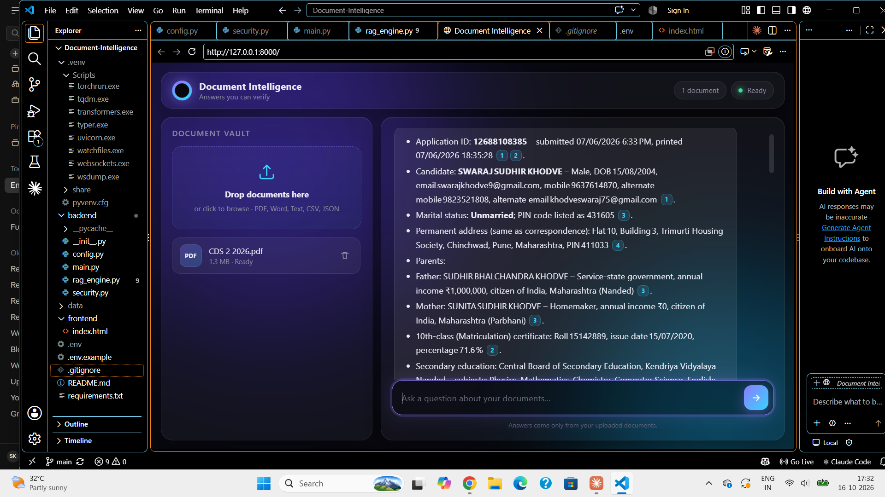

# Enterprise Document Intelligence Engine

Upload your documents, ask questions in plain English, and get answers that cite
the exact file and page or section they came from. If the answer isn't in your
documents, it says so instead of guessing.

**Runs on free tiers only:** Groq (free API key) for answers, and a local
open-source model for document understanding. No billing required.


## Architecture

```
Browser (glassmorphic SPA, no external CDNs)
   │  drag & drop upload · chat · expandable source references
   ▼
FastAPI ── SecurityHeaders ── CORS ── SlowAPI rate limiter
   │
   ├─ POST /api/documents  → magic-byte check → sanitize name → parse → split → embed → ChromaDB
   ├─ POST /api/chat       → prompt-injection filter → retrieve top matches → relevance gate
   │                          → Groq LLM (strict grounded prompt) → cited answer + confidence
   ├─ GET  /api/documents  → vault listing
   └─ DELETE /api/documents/{id}
```

| Layer | Choice |
|---|---|
| LLM | Groq `openai/gpt-oss-20b` (configurable) via `langchain-groq` |
| Embeddings | `all-MiniLM-L6-v2`, local CPU, via `langchain-huggingface` |
| Vector store | ChromaDB, persistent in `data/vault/` |
| Backend | FastAPI + SlowAPI |
| Frontend | Single-file HTML/CSS/JS, dark glassmorphism |

### How hallucinations are controlled (defence in depth)
1. **Relevance gate:** if no passage is similar enough, the LLM is never called and a polite decline is returned.
2. **Strict system prompt:** answer only from supplied context, or output a `NOT_FOUND` sentinel, which is converted to a friendly decline.
3. **Mandatory citations:** every claim must carry a source tag; the UI only shows references the answer actually used.
4. **Temperature 0.**

### Security
- Uploads: extension allow-list (PDF/DOCX/TXT), **magic-byte verification**, DOCX internal structure check, zip-bomb guard, UTF-8 check for text, bounded streaming read, size cap.
- Filenames sanitized (path components stripped, control characters removed); files are stored under **server-generated UUID names** and deleted right after processing.
- SlowAPI rate limits: 15 chat requests/min per client, 6 uploads/min (configurable).
- Prompt-injection guard on questions (pattern screening, Unicode/control-character normalization) **and** on retrieved document text (indirect injection), plus delimiter-based prompting.
- Secrets only from `.env` (`SecretStr`, never logged or returned); `.env` is git-ignored.
- Headers: CSP, `X-Content-Type-Options`, `X-Frame-Options`, `Referrer-Policy`, `Permissions-Policy`, `no-store` on API responses. CORS limited to configured origins.
- Generic error messages to clients; details only in server logs. API docs disabled unless `DEBUG=true`.
- UI renders all model and document text via HTML escaping (no XSS through documents).

## Setup

```bash
git clone <your-repo> && cd document-intelligence
python -m venv .venv && source .venv/bin/activate      # Windows: .venv\Scripts\activate
pip install -r requirements.txt
cp .env.example .env                                   # then paste your free Groq key
touch backend/__init__.py                              # if not already present
uvicorn backend.main:app --host 127.0.0.1 --port 8000
```

Open http://localhost:8000. The first launch downloads the small embedding model (needs internet once).

Add `.gitignore`:
```
.env
.venv/
data/
__pycache__/
```

## Production notes
- Put it behind HTTPS (Caddy, Nginx, or a cloud load balancer) and set `ALLOWED_ORIGINS` to your domain.
- SlowAPI uses in-memory counters. For multiple workers or instances, configure a Redis storage URI.
- - **Private vaults:** each browser gets an unguessable, HMAC-signed, HttpOnly, SameSite=Strict
  session cookie. Every chunk is tagged with that tenant id, and every search, list and delete
  is filtered by it, so visitors can't see each other's documents. Clearing cookies means losing
  access to that vault (the data stays on the server until you purge `data/vault/`).
  For named user accounts, swap the cookie tenant id for the authenticated user's id.
- Set `SESSION_SECRET` in production and `COOKIE_SECURE=true` behind HTTPS.
## Swapping the LLM to Gemini (free tier)
`pip install langchain-google-genai`, then replace `ChatGroq` in `rag_engine.py` with
`ChatGoogleGenerativeAI(model="<current flash model>", google_api_key=...)`.